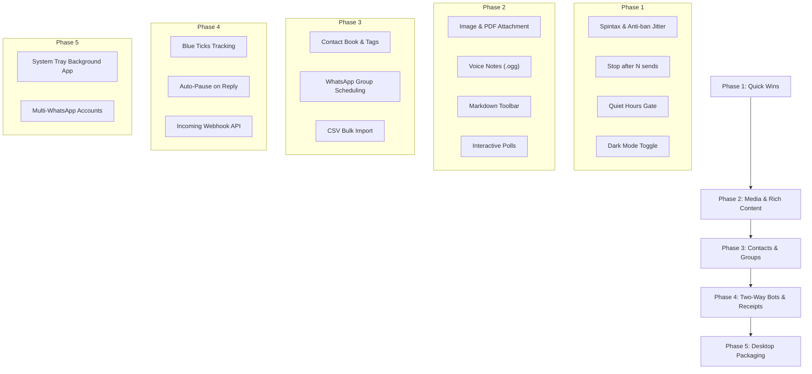

# WhatsApp Message Scheduler — Comprehensive Feature Roadmap

Welcome to the future roadmap for the **Personal WhatsApp Message Scheduler**. This document provides an exhaustive, categorized collection of high-value features, extensions, and technical enhancements that can be built on top of this application.

---

## Quick Reference Summary

| Category | High-Impact Features | Complexity |
|---|---|---|
| **1. Rich Media & Attachments** | Image/Video/PDF attachments, Voice notes, Interactive polls | Medium |
| **2. AI & Dynamic Content** | AI message variations, Spintax (`{Hi\|Hello}`), Anti-ban jitter | Easy to Medium |
| **3. Contact & Audience Tools** | Contact book, Bulk CSV broadcasts, WhatsApp Group scheduling | Medium |
| **4. Two-Way Interactivity** | Read receipt tracking (Blue ticks), Auto-reply triggers, "Stop" keyword | Advanced |
| **5. Advanced Automation** | Quiet hours gate, Annual birthday recurring, Stop after N sends | Easy to Medium |
| **6. Ecosystem & Integrations** | Webhook API for Zapier/n8n, Desktop notifications, System tray app | Medium |
| **7. Multi-Account & Security** | Multi-WhatsApp accounts, Password/PIN protection, Dark mode | Medium |

---

## Category 1: Media, Attachments & Rich Content

### 1.1 Media Scheduling (Images, Videos & Audio)
- **Description**: Enable users to attach photos (`.jpg`, `.png`, `.webp`), short video clips (`.mp4`), or audio files with custom captions.
- **Why it matters**: Great for birthday photos, morning motivation images, memes, promotional flyers, or voice memos.
- **Implementation**:
  - Frontend: Drag-and-drop file uploader with image preview.
  - Backend: Store uploaded files in `data/uploads/` and dispatch via `new MessageMedia.fromFilePath(filePath)` in `whatsapp-web.js`.
- **Complexity**: Medium

### 1.2 Document & PDF Dispatch
- **Description**: Schedule sending reports, invoices, eBooks, or PDF summaries.
- **Why it matters**: Useful for sending daily/weekly timesheets, invoices, or scheduled work reports.
- **Complexity**: Easy

### 1.3 Voice Notes (.ogg / PTT)
- **Description**: Send pre-recorded audio as a native WhatsApp voice note (with microphone icon) rather than a raw audio file.
- **Implementation**: Use `whatsapp-web.js`'s `sendVoiceMessage` or `sendSeen` with `sendAudioAsVoice: true`.
- **Complexity**: Medium

### 1.4 Interactive WhatsApp Polls
- **Description**: Schedule a poll with multiple choices (e.g. "Weekend plan? 1. Movies 2. Dinner 3. Stay home").
- **Implementation**: `new Poll(question, options, pollOptions)` natively supported in `whatsapp-web.js`.
- **Complexity**: Medium

### 1.5 Rich Text Markdown Toolbar
- **Description**: Add visual buttons above the message textarea for WhatsApp formatting:
  - **Bold** (`*text*`)
  - *Italics* (`_text_`)
  - ~Strikethrough~ (`~text~`)
  - `Monospace` (`` `text` ``)
  - Bullet lists (`- item`) and quotes (`> quote`)
- **Complexity**: Easy

---

## Category 2: Smart Content & AI Randomization

### 2.1 Anti-Spam / Smart Delay Jitter
- **Description**: Instead of sending at exact mathematical seconds (e.g., exactly every 15.000s), add random jitter (e.g. 15s ± 3s).
- **Why it matters**: WhatsApp algorithms flag rigid robotic intervals. Humanizing the intervals prevents account shadow-bans.
- **Complexity**: Easy

### 2.2 Spintax Text Spinning
- **Description**: Write templates with syntax like:  
  `"{Hello|Hey|Hi} {Sandip|friend}! {Hope you have a|Wishing you a} {fantastic|wonderful|great} day!"`
- **Why it matters**: Every single sent message is uniquely phrased automatically without writing separate schedules.
- **Complexity**: Easy (Regex replacement using random array picker)

### 2.3 AI Message Generator & Rephraser (Gemini / OpenAI API)
- **Description**: Add an "✨ AI Rephrase" or "✨ AI Variety" button in the form:
  - Input a base thought (e.g. "Remind Rahul to drink water").
  - The AI generates 20 creative, friendly variations stored in a list.
  - The scheduler picks a fresh variation for each execution.
- **Complexity**: Medium

### 2.4 Built-in Dynamic Placeholders
- **Description**: In addition to `{count}`, support:
  - `{name}` — Recipient's name.
  - `{date}` / `{time}` — Formatted local date or time.
  - `{day}` — "Monday", "Tuesday", etc.
  - `{quote}` — Random motivational quote from an offline list.
  - `{weather}` — Real-time weather emoji & temperature (via Open-Meteo free API).
- **Complexity**: Easy

---

## Category 3: Contact Management & Multi-Recipient

### 3.1 Integrated Contact Book & Nicknames
- **Description**: Save frequent contacts with tags (`Family`, `Colleagues`, `VIP`, `Clients`).
- **Why it matters**: Pick from a contact dropdown instead of manually typing phone numbers with country codes every time.
- **Complexity**: Easy to Medium

### 3.2 Scheduled Broadcasts (Multi-Recipient)
- **Description**: Schedule one message to be sent sequentially to 10 or 50 recipients with personalized names.
- **Safety Safeguard**: Built-in 5–15 second spacing between each recipient to avoid WhatsApp bulk-messaging limits.
- **Complexity**: Medium

### 3.3 CSV / Excel Import & Export
- **Description**: Bulk import recipient lists with custom columns (e.g., `Phone`, `Name`, `CustomField`) directly into a scheduled campaign.
- **Complexity**: Medium

### 3.4 WhatsApp Group Scheduling
- **Description**: Fetch the user's active WhatsApp Groups and Communities, allowing scheduled announcements to be posted to groups (e.g. "Weekly Standup Reminder" to a team group).
- **Implementation**: Query `client.getChats()` filtering by `chat.isGroup`.
- **Complexity**: Medium

---

## Category 4: Two-Way Interactivity & Read Receipts

### 4.1 Live Delivery & Read Receipts (Blue Ticks)
- **Description**: Track whether a sent message has been:
  - 🕒 Sent to WhatsApp (`status: accepted`)
  - 🗸 Delivered to device (`ACK_RECEIVED`)
  - 🗸🗸 Read by recipient (`ACK_READ` / Blue ticks)
- **Implementation**: Listen to `client.on('message_ack', (msg, ack) => ...)` and update the execution log in real time.
- **Complexity**: Medium

### 4.2 Auto-Pause on Recipient Reply
- **Description**: If you schedule a reminder or check-in message, automatically pause or complete the schedule as soon as the recipient replies.
- **Implementation**: Listen to `client.on('message', ...)`; if `msg.from === schedule.phone_number`, mark schedule as paused with reason `"Recipient responded"`.
- **Complexity**: Medium

### 4.3 Keyword Unsubscribe / Stop Trigger
- **Description**: If the recipient sends "STOP", "UNSUBSCRIBE", or "PAUSE", the scheduler automatically pauses their active interval/recurring messages.
- **Why it matters**: Prevents spamming friends or contacts who ask to pause automated messages.
- **Complexity**: Easy

### 4.4 Follow-up Automation
- **Description**: "Send follow-up message B only if message A was not answered within 4 hours."
- **Complexity**: Advanced

---

## Category 5: Advanced Automation & Guardrails

### 5.1 Quiet Hours / Sleep Gate
- **Description**: Set global or per-schedule "Quiet Hours" (e.g. 10:00 PM to 07:00 AM).
- **Behavior**: If an interval schedule triggers during quiet hours, it silently pauses or delays until the morning window opens.
- **Complexity**: Easy to Medium

### 5.2 "Stop After N Sends" Limit
- **Description**: Specify a maximum send cap (e.g., "Send every 10 seconds for 50 total messages, then complete").
- **Why it matters**: Perfect companion to the new Auto-Increment feature (e.g. send "I love you 1" to "I love you 100" and stop).
- **Complexity**: Easy

### 5.3 Annual / Yearly Recurrence
- **Description**: Schedules for Birthdays and Anniversaries that trigger once every year on the same date.
- **Complexity**: Easy

### 5.4 Standard Cron Expression Mode
- **Description**: For power users and developers, allow entering raw 5-part cron syntax (`0 9 * * 1-5` for weekdays at 9am).
- **Complexity**: Easy

---

## Category 6: External Integrations & Notifications

### 6.1 Incoming Webhook API
- **Description**: Expose an endpoint:
  ```http
  POST /api/webhooks/send
  Authorization: Bearer <token>
  {
    "phone": "+919876543210",
    "message": "Alert from Server: Backup completed!",
    "delaySeconds": 0
  }
  ```
- **Why it matters**: Allows triggering WhatsApp messages from curl scripts, GitHub Actions, Home Assistant, n8n, or Zapier!
- **Complexity**: Easy

### 6.2 Desktop & Audio Alerts
- **Description**: Play a subtle chime or trigger Windows Native Notifications when:
  - A scheduled message is successfully delivered.
  - A message fails or WhatsApp session gets disconnected.
- **Complexity**: Easy (HTML5 Notification API & Web Audio)

### 6.3 Telegram / Discord Admin Mirror
- **Description**: Send a notification to your personal Telegram bot or Discord webhook whenever a schedule fails or WhatsApp session requires re-scanning.
- **Complexity**: Easy

---

## Category 7: Multi-Account, Security & Desktop Experience

### 7.1 Multi-WhatsApp Account Switcher
- **Description**: Link two or more WhatsApp numbers (e.g., Personal SIM + Work SIM) and choose which sender account sends each schedule.
- **Implementation**: Instantiate separate `Client` instances with separate `clientId` directories in `LocalAuth`.
- **Complexity**: Advanced

### 7.2 Passcode / Screen Lock
- **Description**: Protect the Web Dashboard with a 4-digit PIN or master password stored in SQLite.
- **Why it matters**: Keeps your WhatsApp scheduler and messages private if friends or family use your computer.
- **Complexity**: Medium

### 7.3 Dark Mode / AMOLED Theme
- **Description**: A full dark theme toggle (dark slate / zinc surfaces with emerald accents) for comfortable night usage.
- **Complexity**: Easy

### 7.4 Windows System Tray App (Tauri / Electron)
- **Description**: Package the application into a lightweight desktop app that lives in the Windows System Tray (near the clock).
- **Why it matters**: Launches automatically on Windows boot, runs quietly in the background without keeping terminal windows open.
- **Complexity**: Medium to Advanced

### 7.5 Automated Google Drive / Local Database Backup
- **Description**: Automatically copy `scheduler.db` to a timestamped backup folder or cloud drive once a week.
- **Complexity**: Easy

---

## Suggested Implementation Phases



---

*This roadmap is designed as a modular blueprint. You can pick and implement any single feature from this document independently without breaking existing scheduling workflows.*
